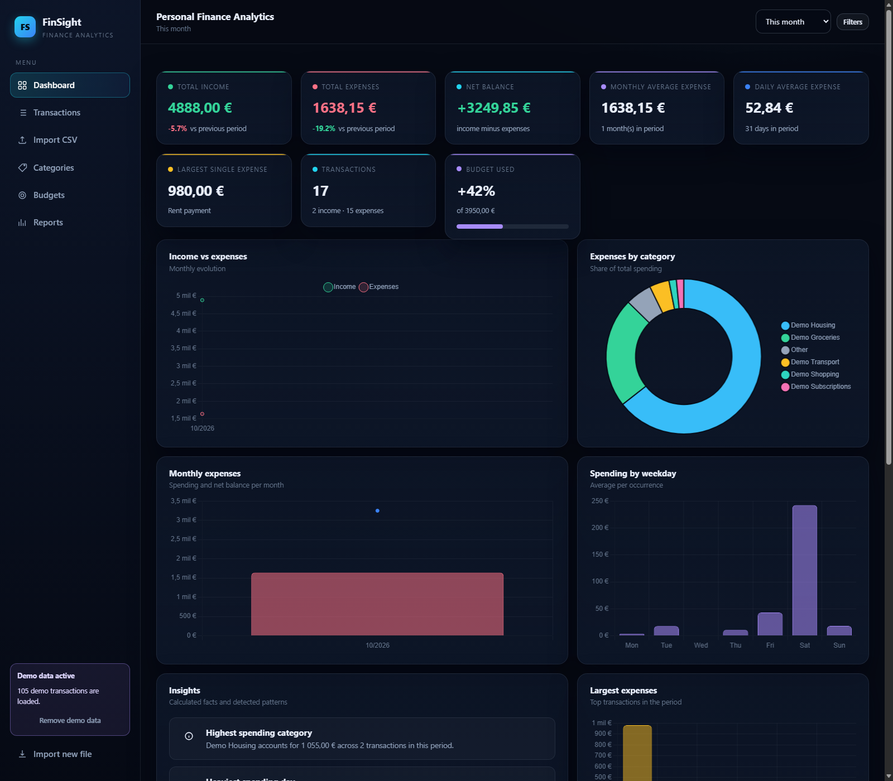
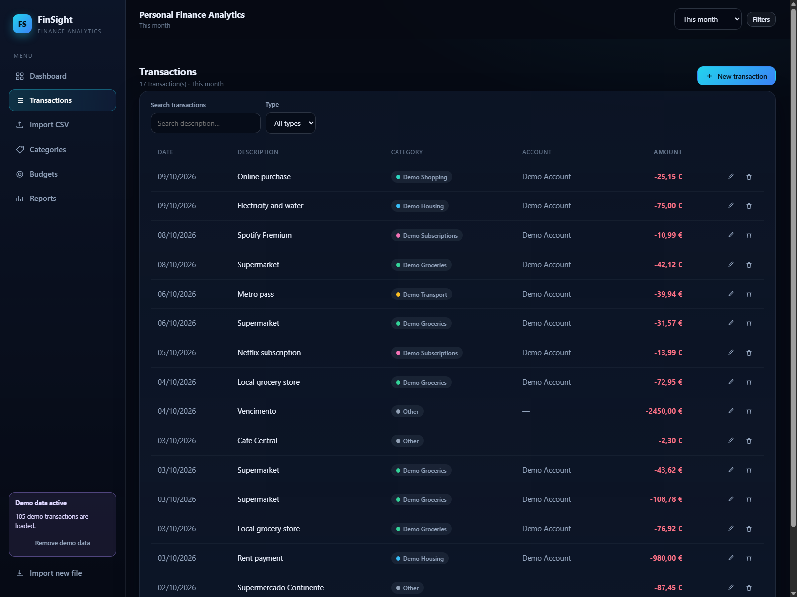
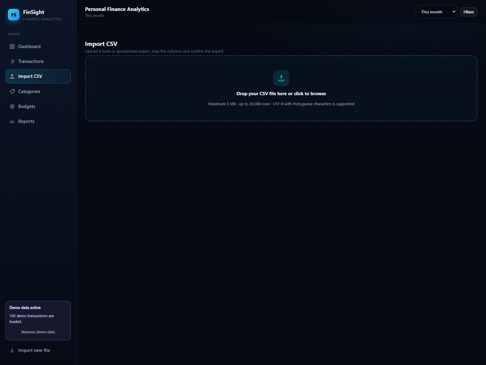
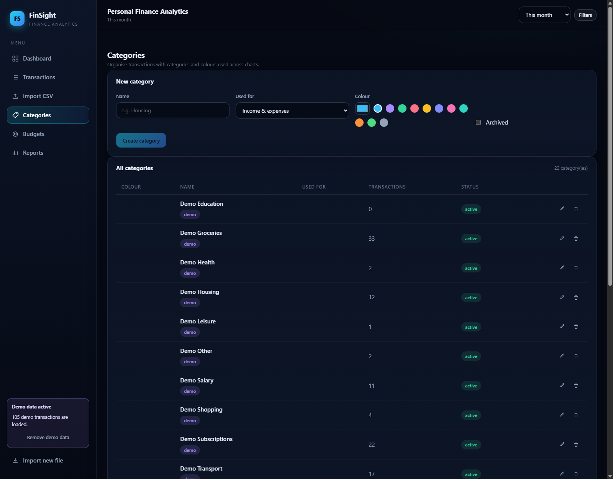
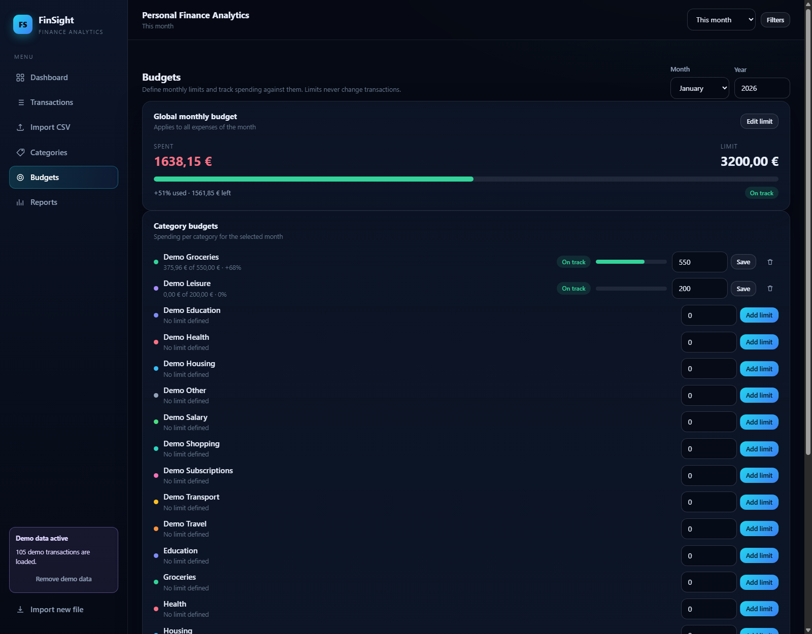
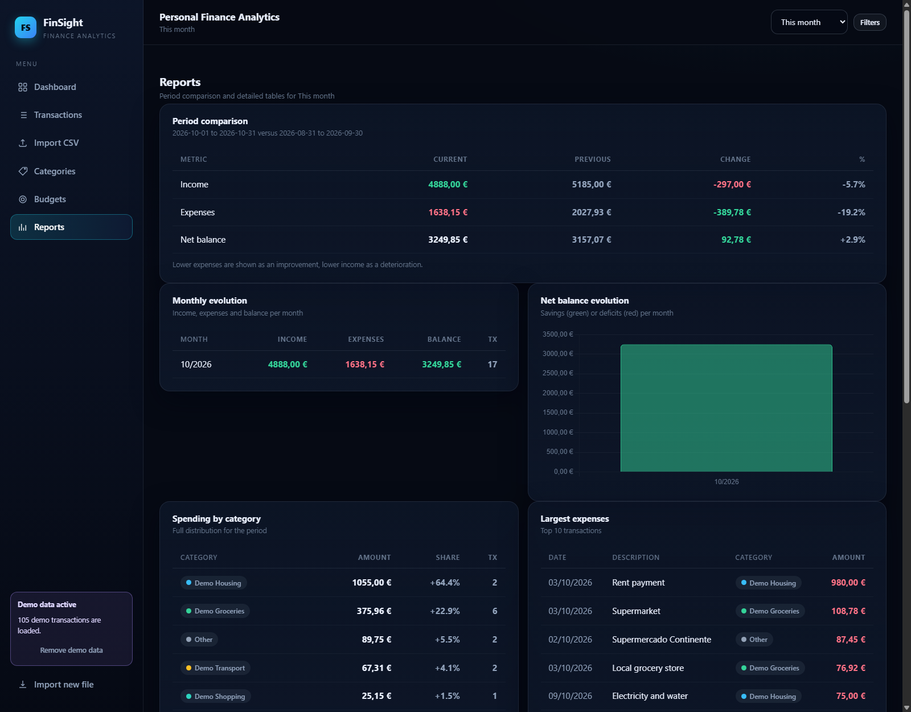

# FinSight — Personal Finance Analytics

A full-stack web application for importing, managing and analysing personal expenses.
Transactions can be imported from CSV bank exports (with column mapping, validation
and duplicate detection) or entered manually. Every metric, chart and insight is
computed on the server from data stored in PostgreSQL — nothing in the UI is hardcoded.



---

## Features

### Dashboard (all values computed from the database)
- Summary cards: total income, total expenses, net balance, monthly and daily average
  expense, largest single expense, transaction counts, budget usage.
- Income vs expenses (line/area) and monthly expenses with net balance (mixed bar/line).
- Expenses by category (doughnut), spending by weekday (average per occurrence).
- Largest expenses chart and a recent transactions table.
- Insights generated from explicit rules (highest spending category, heaviest day,
  largest category increase, top-3 concentration, budget alerts, savings rate,
  *possible* recurring payments flagged as patterns, not as facts).

### Transactions
- Full CRUD with a reactive form (date, description, amount, type, category, account, notes).
- Validation of required fields, amounts, categories and accounts with per-field errors.
- Server-side pagination, sorting, search, type/category/account/period filters.
- Confirmation dialog before deleting.

### CSV import (the core workflow)
1. Drag & drop or browse a CSV file (type and size validated: `.csv`, max 5 MB, 20,000 rows).
2. Preview: delimiter, date format and decimal separator are auto-detected and can be overridden.
3. Column mapping editor for date, description, amount, debit, credit, type, category,
   account and reference columns.
4. Row-level validation with per-row, per-column error messages.
5. Duplicate detection inside the file and against existing transactions
   (date + amount + normalised description + account, or external reference).
6. Ambiguous transaction types are never guessed: the app asks which default to apply.
7. Confirm or cancel, then a final report with imported / rejected / duplicate counts
   and any categories/accounts created automatically.

### Categories and budgets
- Categories with colours, income/expense usage, archive status and delete protection.
- Global monthly budget plus per-category limits with spent / remaining / percentage,
  visual states (on track, close to the limit, exceeded).

### Reports
- Period versus previous equivalent period comparison (absolute and percentage change,
  with direction semantics: lower expenses are good, lower income are bad).
- Monthly evolution table, net balance chart, full category distribution, top 10 expenses.

### Cross-cutting
- Global period filters: this month, last month, last 3/6 months, this year, custom range,
  category multi-select, type, account and free-text search.
- Demo data that is clearly labelled (`Demo …` prefix), seedable and removable with one click.
- Empty, loading and error states everywhere; keyboard navigation and labelled form fields.
- Responsive layout for desktop, tablet and mobile.

---

## Screenshots

| Dashboard | Transactions | Import CSV |
| --- | --- | --- |
|  |  |  |

| Categories | Budgets | Reports |
| --- | --- | --- |
|  |  |  |

---

## Tech stack

| Layer | Technology |
| --- | --- |
| Frontend | Angular 20 (standalone components, signals, reactive forms, router), Chart.js 4, TypeScript 5.9 |
| Backend | ASP.NET Core 8 Web API, Entity Framework Core 8 (Npgsql), Swagger/OpenAPI |
| Database | PostgreSQL 16 |
| Tests | xUnit (unit, service and `WebApplicationFactory` integration tests), Jasmine/Karma for the frontend |
| Tooling | Docker Compose, .NET user secrets / environment variables, EF Core migrations |

### Repository layout

```
FinancialMoney/
├─ backend/
│  ├─ FinSight.sln
│  ├─ src/FinSight.Api/          # Web API, EF Core, services, controllers
│  │  ├─ Domain/                 # Entities and enums
│  │  ├─ Data/                   # DbContext + migrations
│  │  ├─ Dtos/                   # Request/response contracts
│  │  ├─ Services/               # Business logic (finance, import, dashboards, budgets, seed)
│  │  ├─ Controllers/            # REST endpoints
│  │  └─ Middleware/             # ProblemDetails error handling
│  └─ tests/FinSight.Tests/      # xUnit tests
├─ frontend/fin-sight/           # Angular application
│  └─ src/app/
│     ├─ core/                   # models, API services, interceptors, global state
│     ├─ shared/                 # reusable components (chart, stat card, states, dialogs, toasts)
│     ├─ layout/                 # application shell (sidebar, header, filters)
│     └─ features/               # dashboard, transactions, import, categories, budgets, reports
├─ docs/screenshots/
├─ docker-compose.yml            # PostgreSQL 16
└─ .env.example
```

### Architecture

```
┌──────────────────────────────┐        ┌────────────────────────────────┐
│  Angular SPA (standalone,     │  HTTPS │  ASP.NET Core Web API            │
│  signals, Chart.js)            │ ─────► │                                 │
│                               │  JSON  │  Controllers (DTOs, validation)  │
│  core/services/* ─ HTTP       │        │   ├─ TransactionsController     │
│  layout/shell (filters state) │        │   ├─ ImportsController          │
│  features/* (pages)           │        │   ├─ DashboardController        │
└──────────────────────────────┘        │   ├─ CategoriesController       │
                                        │   ├─ BudgetsController          │
                                        │   └─ SeedController             │
                                        │  Services                        │
                                        │   ├─ ImportService (CSV engine)  │
                                        │   ├─ DashboardService (metrics)  │
                                        │   ├─ FinanceCalculator (rules)   │
                                        │   ├─ BudgetService, SeedService  │
                                        │  EF Core 8 ── PostgreSQL 16      │
                                        └────────────────────────────────┘
```

---

## Getting started

### 1. Prerequisites

- .NET SDK 8
- Node.js 20+ and npm
- Docker Desktop (for PostgreSQL)

### 2. Start the database

```bash
docker compose up -d
```

This starts PostgreSQL 16 on `localhost:5432` with a persistent volume.

### 3. Configure the API

```bash
cp .env.example .env         # then edit the values
```

The API reads the connection string from (in order):

1. `ConnectionStrings:Default` (`appsettings.json` or user secrets)
2. the `FINSIGHT_CONNECTION_STRING` environment variable

If neither is set, the API falls back to an **in-memory database** (handy for a quick
look, but data is lost on restart — this is clearly a development fallback).

```bash
cd backend/src/FinSight.Api
dotnet user-secrets set "ConnectionStrings:Default" "Host=localhost;Port=5432;Database=finsight;Username=finsight;Password=finsight"
# or simply export FINSIGHT_CONNECTION_STRING=...
```

CORS defaults to `http://localhost:4200`; override with the `Cors__AllowedOrigins__*`
configuration keys.

### 4. Run migrations and start the API

```bash
cd backend/src/FinSight.Api
dotnet ef database update            # optional: the app applies migrations on start
dotnet run                           # https://localhost:7001 and http://localhost:5155
```

- Swagger UI: <http://localhost:5155/swagger>
- Default categories are seeded automatically on first start
  (`POST /api/seed/demo` creates a removable demo dataset).

### 5. Start the frontend

```bash
cd frontend/fin-sight
npm install
npm start                             # http://localhost:4200
```

The dev server proxies nothing — it calls the API directly at
`http://localhost:5155/api` (see `src/environments/environment.ts`; switch to
`https://localhost:7001` if you trust the .NET development certificate).

### One-command alternative (Docker for Postgres + local processes)

```bash
docker compose up -d
export FINSIGHT_CONNECTION_STRING="Host=localhost;Port=5432;Database=finsight;Username=finsight;Password=finsight"   # PowerShell: $env:FINSIGHT_CONNECTION_STRING=...
dotnet run --project backend/src/FinSight.Api
npm --prefix frontend/fin-sight start
```

---

## API examples

Base URL `http://localhost:5155/api`.

| Method | Endpoint | Purpose |
| --- | --- | --- |
| GET | `/transactions?from=2026-01-01&to=2026-01-31&page=1&pageSize=20&sortBy=date&descending=true` | Paginated, filtered transaction list |
| POST | `/transactions` | Create `{ date, description, amount, type, categoryId, accountId, notes }` |
| PUT / DELETE | `/transactions/{id}` | Update / delete |
| POST | `/imports/preview` | Analyse a CSV (`{ fileName, content, options, mapping }`) |
| POST | `/imports/confirm` | Import the validated rows (`mapping`, `importDuplicates`) |
| GET | `/imports/{id}` | Import batch report |
| GET | `/dashboard/summary?from=…&to=…` | Totals, averages, comparison, budget usage |
| GET | `/dashboard/monthly-trends` | Monthly income/expenses/balance |
| GET | `/dashboard/category-breakdown` | Category distribution |
| GET | `/dashboard/weekday-spending` | Average spending per weekday |
| GET | `/dashboard/top-expenses?count=10` | Largest expenses |
| GET | `/dashboard/insights` | Rule-based insights |
| GET/POST/PUT/DELETE | `/categories`, `/categories/{id}` | Category management |
| GET/POST/PUT/DELETE | `/budgets`, `/budgets/{id}` | Budget management |
| GET | `/budgets/status?year=2026&month=1` | Budget vs actual spending |
| GET/POST/DELETE | `/seed/status`, `/seed/demo` | Demo data lifecycle |

Example response of `GET /dashboard/summary?from=2026-09-01&to=2026-09-30`:

```json
{
  "from": "2026-09-01",
  "to": "2026-09-30",
  "daysInPeriod": 30,
  "monthsInPeriod": 1,
  "totalIncome": 5185.00,
  "totalExpenses": 1893.47,
  "netBalance": 3291.53,
  "averageExpensePerTransaction": 118.34,
  "averageDailyExpense": 63.12,
  "averageMonthlyExpense": 1893.47,
  "savingsRate": 63.48,
  "previousPeriod": { "...": "same-length comparison window with deltas" },
  "budgetUsage": { "hasBudgets": true, "totalLimit": 3950, "totalSpent": 1893.47, "usedPercent": 47.9 }
}
```

---

## Data model

```
Category 1──* Transaction *──1 Account (optional)
Budget *──1 Category (optional → global budget)
ImportBatch 1──* Transaction (optional)
```

| Entity | Key fields |
| --- | --- |
| `Transaction` | `Date`, `Description`, `Amount` (positive magnitude), `Type` (Income/Expense), `CategoryId`, `AccountId?`, `Notes?`, `ExternalReference?`, `ImportBatchId?`, `CreatedAt` |
| `Category` | `Name`, `Color`, `AppliesTo` (Expense/Income/Both), `IsArchived`, `IsDemo` |
| `Account` | `Name`, `AccountType`, `IsArchived`, `IsDemo` |
| `Budget` | `CategoryId?` (null = global), `Year`, `Month`, `LimitAmount`, `IsDemo` |
| `ImportBatch` | `FileName`, `ImportedAt`, `TotalRows`, `ImportedRows`, `RejectedRows`, `DuplicateRows` |

Money is stored as `decimal` / `numeric(18,2)` — never `float` or `double`.
Unique indexes: one budget per category per month and one global budget per month.

---

## Financial rules (implemented in `FinanceCalculator`)

| Metric | Formula | Edge cases |
| --- | --- | --- |
| Total income | Σ amounts where `Type = Income` | — |
| Total expenses | Σ amounts where `Type = Expense` (stored positive) | — |
| Net balance | income − expenses | — |
| Average per expense transaction | total expenses ÷ number of expense transactions | `null` when there are no expenses |
| Daily average expense | total expenses ÷ calendar days in the period | `null` when there are no expenses; days without transactions count |
| Monthly average expense | total expenses ÷ distinct calendar months touched by the period | `null` when there are no expenses |
| Savings rate | net balance ÷ income × 100 | `null` when income is 0 |
| Percentage change | (current − previous) ÷ \|previous\| × 100 | `null` when previous is 0 |
| Previous period | same length, ending the day before the selected period | `hasComparison = false` when it contains no data |
| Budget usage | Σ monthly limits vs total spending of the period | `hasBudgets = false` when no budget exists |

The frontend never recomputes these formulas — it only formats what the API returns.

---

## Testing

Backend (59 tests):

```bash
cd backend
dotnet test
```

Covers: finance formulas (totals, averages, savings rate, percentage change, period
comparison), empty-period behaviour, transaction validation and pagination, budget
rules and conflict detection, CSV preview/confirm (comma and semicolon delimiters,
Portuguese dates, decimal commas, currency symbols, missing columns, invalid values,
in-file and database duplicates, ambiguous type inference, debit/credit columns),
relational behaviour on SQLite (foreign keys created on the fly), demo data
seed/remove cycles, and API integration tests via `WebApplicationFactory`.

Frontend (18 tests):

```bash
cd frontend/fin-sight
npm test        # headless Chromium; on Windows without Chrome set CHROME_BIN to Edge
```

Covers: formatting helpers, the global period filter service, query parameter mapping
in the transaction service and the shared stat card component.

---

## Roadmap

- [x] Transactions CRUD, filters and pagination
- [x] CSV import with mapping, validation and duplicate detection
- [x] Dashboard metrics, charts and insights
- [x] Categories, budgets and budget alerts
- [x] Reports and period comparison
- [x] Demo data lifecycle
- [x] Unit, integration and frontend tests
- [ ] Multi-user accounts and authentication
- [ ] Recurring transaction rules (detected, not guessed)
- [ ] CSV export and scheduled bank imports
- [ ] Budget suggestions based on historical spending

---

## Technical decisions

- **Positive amounts with a `Type` flag.** Amounts are stored as positive magnitudes and
  classified by `Type`. The CSV importer normalises signed amounts, debit/credit columns
  and explicit type columns into this convention and refuses to guess when the data is
  ambiguous.
- **Metrics live in the backend.** The frontend renders API results; there is exactly one
  implementation of each financial formula (`FinanceCalculator`), covered by unit tests.
- **Stateless import.** The preview request carries the file content plus options and
  mapping; confirmation re-parses and re-validates the same payload, so a partially
  edited mapping can never be imported by accident. Row- and column-level errors never
  silently drop rows: they are reported with line numbers.
- **EF Core without extra abstraction.** Controllers talk to services, services talk to
  `FinSightDbContext`; queries are projected into DTOs so no entity is serialised directly.
- **Duplicate detection is conservative.** Exact keys (date + amount + normalised
  description + account, or external reference) are used; duplicates are always shown
  before importing and are skipped unless explicitly opted in.
- **In-memory fallback database.** Without a connection string the API uses EF Core
  InMemory so the app can be started for a quick look; production setups always use
  PostgreSQL. Database migrations are applied automatically on startup when a
  relational provider is configured.
- **Demo data is honest.** It is prefixed with `Demo`, marked with `IsDemo` flags, stored
  in its own account and batch, and can be removed with one call — it is never mixed
  with user data and the dashboard works identically with or without it.

## Known limitations

- Single-user application: no authentication, authorisation or account separation.
- Duplicate detection is exact-key based; fuzzy matching is intentionally avoided.
- Possible recurring payments are surfaced as *patterns* with low confidence, never as
  statements of fact.
- Insights and budgets are computed per selected period; budget alerts consider every
  month touched by that period.
- Frontend unit tests run on Chromium (Chrome, Edge or Chromium via `CHROME_BIN`); no
  end-to-end (Playwright/Cypress) suite yet.
